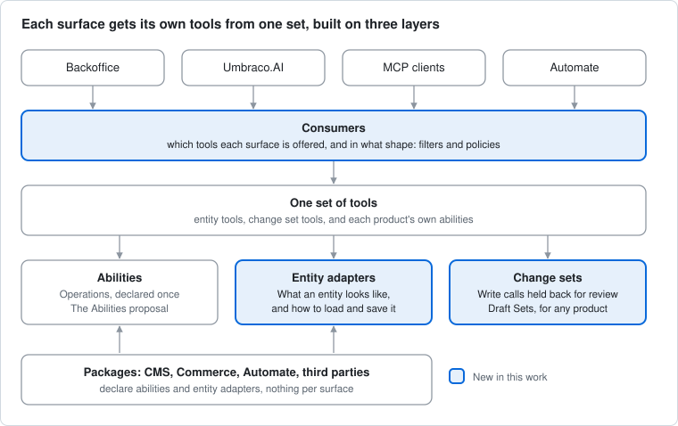

# Abilities, entities and change sets

> **Status:** Experiment. Not a product, not shipped. It started in the [Umbraco.AI](https://github.com/umbraco/Umbraco.AI)
> repo and moved here because it is not AI specific. It tests the design in [docs/ARCHITECTURE.md](docs/ARCHITECTURE.md)
> before anything is built for real.

A proof of concept for one question: **can any surface create and edit any product's entities, with no code written
per product?**

## Why this exists

Many things in Umbraco need to create and change entities: the backoffice, the Umbraco.AI copilot and its tools, MCP
clients, Automate workflows, imports and bulk edits. Today each one does it its own way, and mostly for CMS content only.

| Surface | How it changes entities today | Where it stops |
| --- | --- | --- |
| Umbraco.AI | Content tools and a block path engine | They find editors through CMS content types, so they only work for documents and media |
| MCP | A tool per operation, written by hand | Every new entity type needs new tools |
| Automate | An action per operation | One action can't build a rule tree or a page of nested blocks |
| Backoffice | Each product's own editor | There's no shared way to hold changes back, review them, and apply them together |

Two ideas were already moving:

- **Abilities**: write an operation once, and it shows up as an AI tool, an Automate action and an MCP tool. (Checked
  since: a loader now does this against real Automate, with six workarounds that small Automate changes would remove.
  See [FINDINGS](docs/FINDINGS.md#what-the-loader-fudges).)
- **CMS Draft Sets**: hold content changes back from the live site, review them, then apply them as one unit.

Neither covers the gap between them. An ability is one call, and one call can't build a discount with a tree of rules.
A draft set holds content only, so a discount or a workflow can't join it. This proof of concept fills that gap.

Creating an entity from a description ("10% off the Summer collection for VIP customers in December") was the first
driver, and it is the hardest test. A model has to build a nested entity in small steps, with no help written for that
product. But nothing here is AI specific. The same pieces serve any caller that creates or edits entities.

## The idea

Three pieces, each owned by a contract that never names a product:

| Piece | What it is | What a package writes |
| --- | --- | --- |
| **Abilities** | Operations a package offers, such as "send an email" or "activate a discount". Typed, stateless, and marked as a Read or a Write | An ability class per operation |
| **Entity adapters** | What a package's entities look like (fields, lists of typed items, references) and how to load, check and save one. From this the framework gives every entity the same tools: get the schema, find, get, create, set a value, add, remove and move an item | An editing contract class, plus a mapping to and from the product's own model |
| **Change sets** | Write calls recorded instead of run. The caller sees its own changes, the live site doesn't. A person reviews the set, then applies it, product by product. Changes saved elsewhere meanwhile are rebased onto | Nothing. A product with its own drafts (CMS content) can plug them in |



Every value is reached by a **path** (`rules/{key}/percent`), and every problem comes back on the same path. So any
caller, a model or a person's editor, can fix its own work without a translation step.

## What it would change

This is the design's intent. Only the Umbraco.AI tools and the CMS draft set are built here; the rest is not yet.

| Area | What changes |
| --- | --- |
| **Umbraco.AI** | The content tools and block path engine would become one set of tools over entity adapters. They would then work for Commerce, Automate and third parties, not just CMS content. Approval moves from each step to applying the set |
| **MCP** | One fixed set of tools would cover every entity type that has an adapter. A client names its change set in the `Umb-Change-Set` header. No MCP code per product |
| **Automate** | Abilities become steps. A workflow is itself an entity, so it can be built and edited like any other. A change set could wait in Automate's approval flow |
| **CMS core** | Content changes in a change set are a CMS draft set, which the backoffice can review. The proof of concept lists what core's Draft Sets needs so it could become the change set for every product |
| **Package developers** | Describe an editing contract and map it to the product's model: about 35 lines for a Commerce discount. A plugin (a rule type, a trigger) needs no code at all |
| **Deploy** (an idea, not built) | An entity adapter already does most of what a Deploy connector does, so add-on products could get Deploy support for free |

## What it shows so far

- **One set of tools built four kinds of entity.** A CMS page with a Block Grid, a Commerce discount with nested rules,
  and two Automate workflows, one that branches. See [docs/EXAMPLE-FLOWS.md](docs/EXAMPLE-FLOWS.md), call by call.
- **Plugins need no code.** A third party's discount rule, written as a plain Commerce provider, is usable straight away.
- **Problems come back on edit paths,** so a caller fixes its own mistakes.
- **One change set spans products.** A page, a discount that links to it, and an email to send afterwards are reviewed
  together and applied product by product. A failed step can be fixed and resumed.
- **Changes saved elsewhere are rebased onto.** Only a value both sides changed is a conflict to resolve.
- **It runs on a real Umbraco 18.** Content changes go into a CMS draft set. Umbraco's own validation, permissions,
  notifications, audit log and background queue are used.
- **A real model used it.** Claude Opus 5.5 built discounts and pages from a description, and edited existing pages,
  with only the generic tools, in a few runs.

The details and the lessons are in [docs/FINDINGS.md](docs/FINDINGS.md). The test behind each claim is in
[docs/TESTS.md](docs/TESTS.md).

## What it does not prove

- **Real Automate, and Commerce conflicts.** CMS documents, media and Commerce discounts have real adapters. Members
  would use the same base class, but no member adapter is built. The Automate adapter is still a stand-in. Commerce
  discounts have no version, so a backoffice change made while a set is open isn't noticed.
- **Every Automate connection.** Each exit leads to one step. Automate can also send one exit to several steps, filter
  a connection, give a step with outcomes an "any result" exit, and build Switch's outcomes from its cases. None has a
  field yet; Switch would need exits that change with its settings.
- **Surfaces other than AI tools, HTTP and MCP.** The Umbraco.AI adapter (abilities as M.E.AI `AIFunction`s), two
  Management API endpoints and an MCP proxy that plays the Umbraco CMS MCP Dev server are built. MCP Dev itself isn't
  changed. Claude Code has used the proxy against the demo site, signed in as an API user; other MCP clients are
  not tried. The proxy asks the person before a call that can't be undone (MCP elicitation); only headless Claude
  Code, which can't answer, is tried. Abilities are also Automate actions, against real Automate, and each page type
  gets a Create and an Update action with its own fields and editors. An automation of two such steps runs and saves a
  page. Not shown: that Umbraco's editors work inside Automate's form (never opened in a browser), or that a useful
  page can be built without its blocks, which the forms leave out (see
  [FINDINGS](docs/FINDINGS.md#can-a-person-build-steps-from-abilities)). It needs six workarounds in Automate, and each
  Write step applies its own change set, so a run is not one unit. A backoffice editor would use the same abilities, but isn't
  built here.
- **A real model, at scale.** The tests script the tool calls. One model built discounts and pages, and edited pages, from
  text, on the samples and on the real demo site over MCP. Five real-site descriptions ran five times each and all 25
  were right (see [Against a real model](docs/FINDINGS.md#against-a-real-model)). That is one model and simple
  requests: it doesn't show how other models do, or how it does on harder requests or workflows.
- **Persistence and scale.** Sets are in memory, and working state is recomputed by replaying every call
  on each read.
- **Load balanced sites.** Change sets, waiting approvals and the side effect queue are kept in memory on one server.
  Behind a load balancer, a call can land on a server that doesn't have them. See
  [ARCHITECTURE.md](docs/ARCHITECTURE.md#what-the-cms-already-gives-us).
- **Property editors shipping their own handlers.** The handler contract is in this repo, and only a test's star
  rating uses it from outside the core editors. A real editor package would have to reference Abilities until the
  contract has a home (see [FINDINGS](docs/FINDINGS.md#where-property-editor-handlers-should-live)).
- **Opening a set in an editor.** Nothing loads a set's working state into a backoffice workspace.
- **Undo.** A failed apply is resumed, not undone. Nothing reverses a product's step that already applied.
- **Products sharing a database.** Products that do share a connection could apply in one transaction; the
  PoC applies them one after another. Only CMS documents and media share one, an Umbraco scope.

## Run it

```bash
dotnet test
```

Packages come from nuget.org only, with versions set in `Directory.Packages.props`. The CMS tests start a real
Umbraco 18 on SQLite through `Umbraco.Cms.Tests.Integration`, and take about 30 seconds.

To let a real model build an entity from text, set `ANTHROPIC_API_KEY` and run:

```bash
dotnet run --project tools/Umbraco.Abilities.ModelRun
dotnet run --project tools/Umbraco.Abilities.ModelRun -- "Free shipping over 500 at weekends"
dotnet run --project tools/Umbraco.Abilities.ModelRun -- "On the Summer sale page, make the hero dark" document edit
```

It is not a test: each run calls the Claude API, costs money, and can give a different result. To run it against a real
site such as the demo, through the MCP proxy, also set `UMBRACO_BASE_URL`, `UMBRACO_CLIENT_ID` and
`UMBRACO_CLIENT_SECRET`, and build the proxy first.

## Where to go next

| To | Read |
| --- | --- |
| Understand the design | [docs/ARCHITECTURE.md](docs/ARCHITECTURE.md) |
| See the tools in use, call by call | [docs/EXAMPLE-FLOWS.md](docs/EXAMPLE-FLOWS.md) |
| Review the code, in order | [REVIEWING.md](REVIEWING.md) |
| Make a package's entities editable | [docs/WRITING-AN-ADAPTER.md](docs/WRITING-AN-ADAPTER.md) |
| See how sets apply, rebase, check permissions and use CMS Draft Sets | [docs/CHANGE-SETS.md](docs/CHANGE-SETS.md) |
| Read what building it taught us | [docs/FINDINGS.md](docs/FINDINGS.md) |
| Find the test behind a claim | [docs/TESTS.md](docs/TESTS.md) |

## What is here

| Project | Plays the part of | Depends on |
| --- | --- | --- |
| `Umbraco.Abilities` | The contract and runtime: abilities and their tool shape, entity adapters, the path editor, change sets, the invoker | `Umbraco.Cms.Core`, `Polly.Core` |
| `Umbraco.Abilities.AI` | Umbraco.AI's adapter: every ability's tool becomes an M.E.AI `AIFunction` | Contract, `Microsoft.Extensions.AI.Abstractions` |
| `Umbraco.Abilities.Samples` | Product packages: CMS pages with nested blocks, Commerce collections and discounts, a third-party rule type, an email package, Automate workflows | Contract only |
| `Umbraco.Abilities.Cms` | The real entity adapter for CMS documents, on `IContentEditingService`, the adapter that stages content changes into a CMS draft set, and the `Umb-Change-Set` header middleware | Contract, Umbraco 18, the draft sets stand-in |
| `Umbraco.Abilities.Commerce` | The real entity adapters for Commerce: discounts (rules and rewards from Commerce's own providers), and read-only stores and currencies | Contract, `Umbraco.Commerce.Core` |
| `Umbraco.Abilities.ManagementApi` | Two Management API endpoints: list the abilities, and call one. For HTTP callers such as the Umbraco CMS MCP Dev server | Contract, `Umbraco.Cms.Api.Management` |
| `Umbraco.Cms.DraftSets` | A stand-in for a Draft Sets feature in CMS core: per-property content changes held apart from live, read-through, rebase and conflicts, apply in one scope | Umbraco 18 only: no Abilities |
| `Umbraco.Abilities.Tests` | A scripted model calling the AI tools with JSON arguments | Contract, AI adapter, samples |
| `Umbraco.Abilities.Commerce.Tests` | The Commerce discount adapter against a real Umbraco and Umbraco Commerce on SQLite | Contract, AI adapter, CMS and Commerce adapters, Umbraco test host, `Umbraco.Commerce` |
| `Umbraco.Abilities.Cms.Tests` | The same, against a real Umbraco on SQLite, and the Management API endpoints over HTTP | Contract, AI adapter, CMS adapter, Management API endpoints, MCP proxy, Umbraco test host |
| `tools/Umbraco.Abilities.McpProxy` | The Umbraco CMS MCP Dev server: an MCP server (stdio) whose tools are the abilities a site lists, each call forwarded to the Management API | `ModelContextProtocol` only: no Abilities project |
| `demo/Umbraco.Abilities.Demo` | A small Umbraco 18 site to try the abilities through MCP by hand: SQLite, the Clean starter kit (articles built from blocks), real Umbraco Commerce with a store and products, and an API user for the proxy. See its README | CMS and Commerce adapters, Management API endpoints, `Umbraco.Cms`, `Umbraco.Commerce` |
| `tools/Umbraco.Abilities.ModelRun` | A "Create with AI" surface: a real model (Claude, through M.E.AI's `IChatClient`) builds an entity in a change set from a description | Contract, AI adapter, samples, `Anthropic` |

## Words we use

| Word | Means | Code |
| --- | --- | --- |
| Ability | One operation a package offers, marked as a Read or a Write | `IAbility`, `AbilityBase` |
| Adapter | What a package writes once per entity type: it loads, saves, finds and checks that product's entities | `IEntityAdapter` |
| Entity | One entity's key, type and field values, as one JSON tree | `Entity` |
| Schema | What an entity looks like: its fields, item types and the dimensions values vary by | `EntitySchema`, `ObjectSchema` |
| Field | One named value on an entity, item or object | `FieldDefinition` |
| Item | One keyed, typed object in a list: a block, a rule, a workflow step | `ItemTypeDefinition` |
| Path | Where a value is: field names and item keys, never positions (`blocks/{key}/heading`) | `EntityValues.Find` |
| Change set | Write calls held back from live, to review and apply together | `ChangeSet` |
| Draft set | The CMS's own version of a change set, for content only | `Umbraco.Cms.DraftSets` |
| Side effect | A Write that changes nothing reviewable, such as sending an email. It runs after apply | `ChangeSet.AfterApply` |
| Summary | A short view of an entity returned to the caller: type, key, name and edit link | `EntitySummary` |
| Reference | A stored pointer to another entity: type and key | `EntityReference` |
