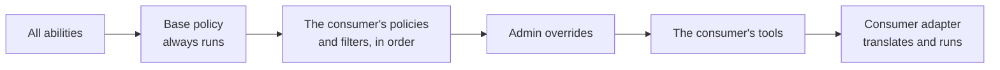

# Consumers: which abilities show up where, and in what shape

Status: **phases 1 to 3 built** (tasks 1 to 14). Phase 4 is the plan.

A **consumer** is anything that offers abilities to someone: an AI chat, an MCP server, Umbraco Automate. Today each
consumer filters and shapes the abilities list in its own code. This plan keeps that job with the consumer, but builds
it from **filters**: named, pluggable steps that any package can add, grouped into **policies** that any consumer can
apply by name.

This is the part most likely to decide if the PoC works. If every ability shows up everywhere, the lists are cluttered
and confusing. If each consumer hard-codes its own filter, the abilities are no longer cross-product.

The pattern is "pipes and filters": a list passes through filters, one after another. The names follow what .NET
developers already know:

| Name here | Known from |
| --- | --- |
| Filter | The MCP C# SDK's `AddListToolsFilter` (2.3.1, already used here). A filter here can drop, change or split a tool, not only remove it, as in "pipes and filters" and ASP.NET's MVC filters |
| Policy | ASP.NET Core's `AddPolicy("name", …)` for CORS, rate limiting, output caching and authorization: register once by name, apply by name |
| Base policy | ASP.NET Core output caching's `AddBasePolicy`: runs everywhere, before named policies |
| Tool | M.E.AI and MCP: what a caller is offered. `AbilityTool` already means an ability shaped for a caller |
| Consumer | Not "surface": Umbraco's `SurfaceController` already means something else to every Umbraco developer |

## The idea in one table

| Who | Does | Never does |
| --- | --- | --- |
| An ability | States facts about itself: what it does, if it writes, if it can be undone, if it is a building block | Names a consumer |
| A filter | Drops, changes or splits a tool, and leaves a note saying why | Knows which consumer runs it |
| A policy | Groups filters, and other policies, under one name | Holds code of its own |
| A consumer | Defines itself, and lists the policies and filters it applies, in order | Writes filtering or shaping code inline |
| The framework | Runs the base policy, then the consumer's list, then the admin's overrides, and hands over the tools | Anything about one product or one consumer |
| An admin | Overrides, by consumer and ability id | Anything else |
| A consumer adapter | Translates the tools (to an AIFunction, an MCP tool, an Automate action) and runs a call | Filtering or shaping |



## The problem today

Every place below is a consumer filtering or shaping in its own code.

| Where | What it decides | Becomes |
| --- | --- | --- |
| `AbilityTool.cs:86` | Adds `changeSetId` to every ability that uses a change set | Filter `add-change-set-argument` |
| `AbilityAIFunction.cs:21`, `:59` | Strips `x-editor` and `x-meta` from schemas and results | Filter `strip-form-keywords` |
| `AbilitiesMcpProxy.cs:189` | A second copy of the stripping | The same filter, run on the site |
| `AbilitiesMcpProxy.cs:223` | Its own idea of a listed ability | The consumer's tools |
| `AbilitiesController.cs:81-91` | Lists every ability, unshaped | `GET abilities`, for the consumer in the `Umb-Consumer` header |
| `AbilityAction.cs:112` (Automate) | Hard-codes: no change set lifecycle, no Explain, no building blocks | The base policy and two filters |
| `AbilityAction.cs:83` (Automate) | Decides if a step makes its own change set | Filter `change-set-per-call` |
| `EntityAction.cs` (Automate) | Makes per-page-type Create and Update, only for Automate | `entity.create`, `entity.update` and filter `split-by-entity-type` |

Problems this causes:

- **Clutter.** Automate shows "Article Controls" and other types nobody can create, one Create per page type.
- **Copies drift.** The MCP stripping is a copy of `UiHints.ForModels`. A new UI keyword needs two edits.
- **No reuse.** A new consumer (a backoffice command palette, a Forms workflow, Deploy) has to copy Automate's code.
- **No control.** An admin can't say "not in Automate" or "only these in MCP".
- **No why.** Nobody can ask "why is this ability not in Automate?" and get an answer.

## Concepts

### 1. Ability facts

Abilities keep stating facts, never consumers. Filters read them. Most exist today.

| Fact | Today | Change |
| --- | --- | --- |
| `Kind` (Read, Write, Explain) | Yes | None |
| `Reversible`, `RequiresApproval` | Yes | None |
| `UsesChangeSet` | Yes | None |
| `Granular` (a building block) | Yes, this branch | None |
| Manages change sets | The `IChangeSetLifecycleAbility` interface | Becomes a descriptor fact, `ManagesChangeSets`, so filters read one place |
| Input depends on a choice | No | New: `DependentInput`. Part of the input's shape depends on a value in it, such as the fields of the chosen page type |
| An argument with few, stable values | No | New: `SplitBy`. Names an argument a filter may split on, such as `entityType` |
| Description and hints | One description, mostly written for models | Split: a description for every reader, and hints for one audience (section 9) |

### 2. Tools

A **tool** is one ability, shaped for one consumer. Filters work on tools. A tool starts as its ability, as it is.

`AbilityTool` already meant this, so it kept the name. It used to run calls too, with a session; that part is now
`AbilityToolRunner` (section 12), and `AbilityTool` is the shape only.

```csharp
public sealed record AbilityTool
{
    public AbilityTool(IAbility ability);        // The ability as it is: the starting point every filter works on.

    public required IAbility Ability { get; init; }
    public required string Id { get; init; }      // The ability's id, plus a suffix when split: "entity.create:document".
    public string Name => ToToolName(Id);         // What a caller calls it by: "entity_create_document".
    public required string Title { get; init; }   // What a person calls it, as MCP's "title": "Create Document".
    public required string Description { get; init; }
    public required JsonElement InputSchema { get; init; }
    public JsonElement? OutputSchema { get; init; }
    public IReadOnlyDictionary<string, JsonElement> FixedArguments { get; init; }   // Set by a split, added on every call.
    public ChangeSetMode ChangeSetMode { get; init; }
    public FilterNote? Dropped { get; init; }     // A dropped tool stays listed, so an admin screen can say why.
    public IReadOnlyList<FilterNote> Notes { get; init; }

    public AbilityTool Drop(string reason);
    public AbilityTool Note(string text);
}

public sealed record FilterNote(string Text) { string? Filter; string? Package; string? Policy; }  // The provider fills these in.
```

Built with two changes from the first sketch:

- **`Name` stays the tool name, and the display name is `Title`.** Every consumer, and many tests, already key tools by
  `Name`. MCP uses the same pair.
- **Schemas are `JsonElement`, not `JsonObject`.** A record copied with `with` shares its members; an immutable schema
  can't be changed by accident through a copy.

### 3. Filters

One kind of filter. It returns the tool unchanged, changed, dropped, or several tools in its place.

```csharp
/// <summary>
/// One step in a consumer's list. Despite the name, it doesn't only remove: it can drop a tool, change it, or put
/// several in its place. Named after the MCP C# SDK's list-tools filters, which do the same.
/// </summary>
public interface IAbilityFilter
{
    string Alias { get; }
    string Description { get; }   // For the admin screen.
    IEnumerable<AbilityTool> Apply(AbilityTool tool, AbilityFilterContext context);
}

/// What a filter can read: the consumer, and the site's services (adapters, the keyword list).
public sealed record AbilityFilterContext(IAbilityConsumer Consumer, IServiceProvider Services);
```

Helpers keep filters short: `tool.Drop("a person builds a step from a form, not from paths")`, and
`tool.Note("…") with { Description = … }`. A filter writes only a note's text; the provider adds the filter's alias,
its package (the filter's assembly) and the policy that listed it.

Filters are pluggable, like abilities. A package adds them to the site's registry, as it adds abilities to
`AbilityRegistry`:

```csharp
filters
    .Add(new HideBuildingBlocks())
    .Add(new SplitByEntityType());
```

The built-in filters:

| Filter | Does |
| --- | --- |
| `hide-building-blocks` | Drops Granular abilities |
| `hide-explain` | Drops Explain abilities |
| `strip-form-keywords` | Removes keywords meant for forms (section 8) from schemas, and from results |
| `add-change-set-argument` | Adds `changeSetId` to tools whose mode is Caller |
| `change-set-per-call` | Sets the mode to PerCall: the consumer makes one set per call, applies it, or discards it on failure |
| `split-by-entity-type` | One tool per entity type that can create, named from the adapter ("Create Document"), with `entityType` fixed |
| `form-fields-only` | Leaves out fields that hold items, such as blocks, from a dependent input's fields |
| `apply-hints` | Keeps the hints for the consumer's audience, adds them to each description, and removes `x-hints` (section 9) |

A package adds its own. For example, Commerce could add `hide-discounts-without-currency`.

### 4. Policies

A policy is a named list of filters, run in order. It can list other policies. A consumer applies it by name.
Policies are pluggable too.

```csharp
policies
    .Add("for-models", "strip-form-keywords", "add-change-set-argument", "apply-hints")
    .Add("for-forms", "hide-building-blocks", "hide-explain", "change-set-per-call",
         "split-by-entity-type", "form-fields-only", "apply-hints");
```

- A loop (a policy that lists itself, directly or not) is refused when the site starts.
- A package can add a filter to a policy (`policies.AddToPolicy("for-forms", "…")`). Every consumer that applies the policy gets
  it. That is the point: a new form keyword, or a new kind of building block, is handled once. Its note names the
  package and the policy.
- A consumer can apply a policy and then its own filters. It can't take a filter out of a policy. If it needs to, it
  lists the filters itself.

### 5. The base policy

Two filters protect against harm, not clutter. They are the **base policy**: they run first, for every consumer, and no
consumer or admin can switch them off. They read the consumer's capabilities, so a consumer can't skip them by leaving
them out of its list.

| Filter | Drops when | Replaces |
| --- | --- | --- |
| `consent` | The ability needs approval, and the consumer can't ask and has no standing consent | Nothing today. A gap |
| `change-set-lifecycle` | The ability manages change sets, and the consumer has no conversation to keep one open in | Automate's `IChangeSetLifecycleAbility` check |

A package can add a filter to the base policy (`policies.AddToBasePolicy(...)`), to protect against a harm of its own.
It can't remove one. The framework's two are added with `filters.AddFrameworkFilters(policies)`.

### 6. Consumers

A consumer defines itself, and lists the policies and filters it applies.

```csharp
public interface IAbilityConsumer
{
    string Alias { get; }          // "automate", "ai-chat", "mcp". Stable: overrides are keyed by it.
    string Name { get; }           // "Umbraco Automate"
    string Description { get; }    // For the admin screen.
    string Audience { get; }       // Who reads its text: "model" or "person". Picks the hints (section 9).
    ConsumerCapabilities Capabilities { get; }  // Read by the base policy.
    IReadOnlyList<string> Filters { get; }      // Policy or filter aliases, applied in this order.
}

[Flags]
public enum ConsumerCapabilities
{
    None = 0,
    Conversation = 1,     // Holds a session across calls, so a change set can stay open between them.
    AsksConsent = 2,      // Can stop and ask a person before one call (AI chat approval, MCP elicitation).
    StandingConsent = 4,  // A person agreed ahead of time (publishing an automation).
}

consumers.Add(new AbilityConsumer("automate", "Umbraco Automate", "…", AbilityAudiences.Person,
    ConsumerCapabilities.StandingConsent, ["for-forms"]));
```

The PoC's consumers:

| Alias | Audience | Capabilities | Applies |
| --- | --- | --- | --- |
| `ai-chat` | model | Conversation, AsksConsent | `for-models` |
| `mcp` | model | Conversation, AsksConsent | `for-models` |
| `automate` | person | StandingConsent | `for-forms` |

A new consumer gets a sensible list on day one by applying one policy.

The Management API is not a consumer. It is the road MCP travels. A caller names its consumer
in the `Umb-Consumer` header, set once on its client. Without it, the caller is `mcp`. The consumer is who calls, not
what is asked for, so it is a header, like `Umb-Change-Set` and `Umb-Approval`. The list answers with
`Vary: Umb-Consumer`, so a cache keeps one list per consumer.

### 7. Adding a filter to another package's consumer

```csharp
consumers.AddFilter("automate", "hide-discounts-without-currency");
```

- It runs after the consumer's own list.
- Its note names the package, so the admin screen shows who changed the list.
- It can't remove or reorder the consumer's own filters.

### 8. Schema keywords declare their audience

One list of the `x-` keywords, each with who it is for. `strip-form-keywords` reads it, at any depth, in input
schemas, output schemas and results (a result can hold a schema).

| Keyword | For | Why |
| --- | --- | --- |
| `x-editor` | Forms | The editor a form shows |
| `x-meta` | Forms | Hints for UIs |
| `x-references`, `x-references-item-in` | Both | A model uses it to find keys; a form uses it to show a picker |
| `x-edit`, `x-item-types`, `x-variations`, `x-bindings` | Both | Rules a caller acts on |
| `x-hints` | One audience each | Read and removed by `apply-hints` (section 9) |

A package that adds a keyword registers it with its audience. A keyword not on the list is kept, so nothing disappears
by accident. This replaces `UiHints.ForModels` and the MCP proxy's copy.

### 9. Descriptions and hints

Two kinds of text, on abilities and on fields:

| Text | Says | Read by |
| --- | --- | --- |
| Description | What the field is, or what the ability does | Every reader. Written so a person and a model both follow it |
| Hints | How to use it | One audience each |

The test: if a sentence only helps one kind of reader, it is a hint.

Hints are keyed by **audience**, not by consumer or product. Two audiences to start, `model` and `person`. A consumer
says which it serves (section 6), so Umbraco.AI and MCP get the same hints without either being named. The list of
audiences is open: a package can add one if it ever needs to.

```csharp
[Ability("entity.setValue", "Set a value",
    Description = "Sets one value on an entity.",
    Granular = true)]
[Hint(AbilityAudiences.Model, "Paths look like title, or blocks[2].heading. Call entity.getSchema first to see them.")]
public sealed class SetValueAbility : ...

public sealed record SetValueInput(
    [property: Description("The value's path.")]
    [property: Hint(AbilityAudiences.Model, "Use the paths entity.getSchema lists; an item's path ends in its index.")]
    string Path, ...);
```

| Example | Description | Model hint | Person hint |
| --- | --- | --- | --- |
| `entity.setValue` | Sets one value on an entity. | Paths look like `title` or `blocks[2].heading`. Call `entity.getSchema` first | None |
| The `writer` field | The article's author. | A page key. Find one with `content.search` | None: the picker says enough |
| An Update form's field | The article's title. | None | Leave empty to keep it as it is |

Where hints come from:

- **Abilities and their inputs:** the `[Hint(audience, text)]` attribute.
- **Adapters:** `FieldDefinition.Hints`, from product knowledge. The blocks handler tells a model to add items with
  `entity.addItem`.
- **Filters:** a filter can add a hint for its own reason, such as the "leave empty" hint on an Update form.
- **Advice about one consumer** belongs to that consumer's own filter or adapter, never to the ability. "Bind to an
  earlier step with `${ … }`" is Automate's.

How it reaches a consumer:

- The schema carries hints as `x-hints: { "model": "…", "person": "…" }`, beside `description`.
- `apply-hints` keeps the consumer's audience's hint, adds it to the description, and removes `x-hints`. No consumer
  has a separate slot for hints today. One that does can drop `apply-hints` and read `x-hints` itself.
- The same filter shapes results, so a schema a model reads back from `entity.getSchema` has model hints only.

Moving the text over: today's descriptions are mostly written for models. Each is split once: the part every reader
needs stays as the description, the model-only detail becomes a model hint. A model then reads the same text as today.

Built (task 14):

- `[Hint(audience, text)]` goes on an ability class, an input property or a model property. The fluent set-up has
  `.Hint(audience, text)` on fields and items fields. Two hints for one audience are joined.
- `FieldDefinition.Hints` is written as `x-hints`. An adapter that builds fields by hand sets it directly.
- `apply-hints` is the first filter in both `for-models` and `for-forms`.
- Every framework description was split. A model reads nearly the same text as before. Three inputs lost a bracket
  or a comma to the split (the item type aliases, the item type, the conflict's path), and in
  `changeSet.resolveConflict` "changes nothing live" now comes before the hint to ask the person.
- The sample discount's `active` field has a person hint, so a form shows text a model never reads.

### 10. How a call runs

```csharp
public enum ChangeSetMode
{
    None,        // Reads, or an ability that doesn't use a set.
    Caller,      // The caller picks or opens one (changeSetId). The default for an ability that uses a set.
    PerCall,     // The consumer makes one set for this call, applies it, or discards it on failure. Automate steps.
}
```

The tool tells the adapter which mode it has, so the adapter doesn't decide. Things about transport stay in the
adapter: the Management API's `Umb-Change-Set` and `Umb-Approval` headers, M.E.AI's approval wrapper, MCP's tool
annotations.

### 11. Admin overrides

Run last, on ability ids (a split tool shares its ability's id). An override can drop anything, and bring back anything
a consumer's filters dropped. It can't bring back what the base policy dropped.

Config first:

```json
"Umbraco": {
  "Abilities": {
    "Consumers": {
      "automate": { "Exclude": [ "email.*" ] },
      "mcp":      { "Include": [ "entity.setValue" ], "Exclude": [ "commerce.discount.*" ] }
    }
  }
}
```

- Patterns match ability ids, with `*` at the end.
- Read through `IAbilityOverrides`, so a store in the database can replace config later.

Later, a layer below the admin: one Automate workspace or one AI agent profile narrows what its consumer offers. It can
only narrow, never widen.

A central backoffice screen would edit the site layer: one table per consumer, each row an ability, kept or dropped,
and the notes. That screen belongs in core and would go through Umbraco's RFC process. The PoC stops at config.

### 12. The tool provider

What every adapter reads, and all it reads. Built as a class, `AbilityToolProvider`; the runner runs the calls.

```csharp
public sealed class AbilityToolProvider
{
    /// The kept tools, after every filter (and later, every override).
    public IReadOnlyList<AbilityTool> GetTools(string consumerAlias);

    /// Every tool, kept or dropped, with every note. What an admin screen and a test read.
    public IReadOnlyList<AbilityTool> Explain(string consumerAlias);

    /// Checks every policy and consumer. Run when the site starts.
    public void Validate();

    // Still to build:
    /// A result, shaped by the same filters (a result can hold a schema).
    public JsonElement ShapeResult(string consumerAlias, string toolId, JsonElement result);

    /// A dependent input's schema once a choice is made, such as the page type, shaped by the same filters.
    public Task<JsonObject> ResolveInputSchemaAsync(string consumerAlias, string toolId, JsonObject chosen, CancellationToken ct = default);
}

public sealed class AbilityToolRunner
{
    /// Runs a tool: adds its fixed arguments, handles its change set mode, checks consent, and calls the ability.
    public Task<AbilityToolResult> InvokeAsync(AbilityTool tool, JsonObject arguments, AbilityToolSession session, AbilityConsent consent = default, CancellationToken ct = default);
}
```

- `Validate()` checks that each name is a filter or a policy, never both, and that no policy lists itself.
- Not cached yet. It will be per consumer, cleared when abilities, filters or policies change.
- A dependent input is resolved per call, so a page type added later can be picked without a restart.
- "Why is `entity.setValue` not in Automate?" is one note: `hide-building-blocks (Umbraco.Abilities, policy for-forms):
  a person builds a step from a form, not from paths.`

### 13. What stays in each adapter

| Adapter | Keeps | Loses |
| --- | --- | --- |
| AI (`AbilityAITools`) | Wrap in `AIFunction`; approval wrapper; turn arguments into JSON | Stripping; the list |
| Management API | HTTP; headers to `changeSetId`, consent and the consumer | Its own list shape |
| MCP proxy | MCP tools and annotations; asking for consent | Stripping; `ListedAbility`'s own shaping |
| Automate | `IAction`; forms from `x-editor`; bindings; editor values; Automate's object-only output rule | `Include`; deciding the change set; `EntityAction` |

### 14. One Create and one Update per entity type

A person thinks "Create Document" or "Create Discount", then picks the page type. Not one action per page type. This
is the shape Automate's own Create Content already has, and lists stay short however many page types a site has.

The abilities:

- `entity.create` takes the entity type, the subtype and the fields. It becomes a whole operation, not a building
  block (`Granular = false`).
- A new `entity.update` takes a key and the fields to change, in one call, through the change set. Values left out
  stay as they are. It calls `entity.setValue` underneath, which stays a building block.
- Both state `DependentInput` (`fields` depends on `entityType` and `subtype`) and `SplitBy = "entityType"`.

How they reach each consumer:

| Consumer | Lists | The type choice | The fields |
| --- | --- | --- | --- |
| AI chat, MCP | One `entity_create` and one `entity_update` | Arguments, as today | `entity.getSchema`, as today. Nothing changes for models |
| Automate | "Create Document", "Update Document", "Create Discount", ... | A page type picker | **Needs Automate's help.** See below |

Underneath, an Automate step does what a model does: one change set, one `entity.create` or `entity.update` call, then
apply. Checks, permissions, all-or-nothing saves and error paths are the abilities' own.

Automate can change an action's output by its settings (`HasDynamicOutputSchema`), but not its form. Until it can, a
FUDGE: one custom field editor that loads the chosen type's fields (`ResolveInputSchemaAsync`) and shows their editors.
Automate tweak to ask for, added to the list in FINDINGS: **a settings form that depends on the settings**, the same
pattern as the dynamic output schema. Automate's own Create Content would gain real editors from it too, in place of
its JSON property box.

### 15. Only types a person can create

```csharp
public sealed record EntitySubtype(string Alias, string Name, bool Creatable = true);
```

- The CMS adapter sets `Creatable` when the type is allowed at the root, or as a child of some type. Element types and
  compositions such as "Article Controls" are not.
- The page type picker on Create offers only creatable types. Update picks an existing page, so its type is known.
- `entity.create` refuses a subtype that isn't creatable, with a clear problem, for models too.

## Ordered tasks

Each task keeps the full suite green. Each is one PR-sized step.

| # | Task | Shows |
| --- | --- | --- |
| 1 | Done. `AbilityTool` as the shape only; calls move to `AbilityToolRunner`, which every consumer and test now uses | The suite passes; tests changed only in how they make and run a tool |
| 2 | Done. `IAbilityFilter`, `AbilityFilterRegistry`, notes and drop helpers | A package adds a filter with no framework change |
| 3 | Done. Policies, loop check, `AddToPolicy` | A filter added to a policy reaches every consumer that applies it |
| 4 | Done. `IAbilityConsumer`, `AbilityConsumerRegistry`, `AddFilter`; `GetTools`, `Explain`, `Validate` | A package adds a consumer with no framework change |
| 5 | Done. `ManagesChangeSets` fact; the base policy | It runs for every consumer and can't be skipped |
| 6 | Done. The built-in filters and policies; the three PoC consumers, each registered by its own package | Automate's list is the same as its old `Include`; every drop has a note |
| 7 | Done. `strip-form-keywords`, also on results (`IAbilityResultFilter`, `ShapeResult`) | `UiHints.ForModels` and the MCP copy deleted |
| 8 | Done. `ChangeSetMode.PerCall` in the runner; `add-change-set-argument`; `change-set-per-call` | `changeSetId` only where there is a conversation |
| 9 | Done. The AI adapter reads the `ai-chat` consumer's tools | The AI adapter shrinks; its list is unchanged |
| 10 | Done. The `Umb-Consumer` header on `GET abilities` and `POST …/invoke` (`mcp` without it); the MCP proxy sets it once | The proxy's stripping and shaping deleted; a tool a consumer doesn't offer is a 404 |
| 11 | Done. Automate reads the `automate` consumer's tools | `AbilityActionOptions.Include` deleted |
| 12 | Done in phase 1. `AddFilter` onto another package's consumer | A package adds a filter to a consumer it doesn't own |
| 13 | Done. Overrides from `Umbraco:Abilities:Consumers` | An admin drops or keeps, and can't keep past the base policy |
| 14 | Done. Hints: `[Hint]`, `FieldDefinition.Hints`, `x-hints`, `apply-hints`; split today's descriptions | Automate shows text for people; a model reads the same text as today |
| 15 | `entity.update`, `DependentInput`, `SplitBy`; `split-by-entity-type`; `ResolveInputSchemaAsync` | One Create and one Update per entity type for forms; one tool each for models |
| 16 | Automate: page type picker and the fields editor (FUDGE) | `EntityAction` deleted |
| 17 | `Creatable` subtypes in the CMS adapter | "Article Controls" can't be picked |
| 18 | Docs: ARCHITECTURE (a consumers layer), FINDINGS, TESTS, README, REVIEWING | |

## Test plan

New tests, in the repo's sentence style:

- `A_package_adds_a_filter_and_a_consumer_applies_it_without_any_framework_change`
- `A_package_adds_a_consumer_and_gets_a_list_from_one_policy`
- `Filters_run_in_the_order_the_consumer_lists_them`
- `A_filter_added_to_a_policy_reaches_every_consumer_that_applies_it`
- `A_policy_that_lists_itself_is_refused_at_start_up`
- `A_package_adds_a_filter_to_another_packages_consumer_and_its_note_names_the_package`
- `An_ability_that_needs_approval_is_dropped_where_nobody_can_agree_to_it_whatever_the_consumer_applies`
- `Automate_gets_whole_operations_and_no_building_blocks_lifecycle_or_explain_abilities`
- `An_AI_chat_gets_the_same_abilities_as_before_consumers_existed`
- `Every_dropped_ability_says_which_filter_dropped_it_and_why`
- `An_admin_can_drop_an_ability_from_one_consumer_only`
- `An_admin_can_bring_back_what_a_filter_dropped_but_not_what_the_base_policy_dropped`
- `A_model_never_sees_keywords_meant_for_forms_in_a_schema_or_a_result`
- `A_consumer_that_makes_a_set_per_call_gets_no_changeSetId_argument`
- `A_model_reads_the_description_with_model_hints_and_a_person_with_person_hints`
- `Two_consumers_with_the_same_audience_get_the_same_hints`
- `A_model_reading_a_schema_back_gets_model_hints_only`
- `Automate_lists_one_Create_per_entity_type_and_a_model_gets_one_create_tool`
- `Choosing_a_page_type_gives_a_form_of_its_fields_with_their_editors`
- `A_page_type_added_later_can_be_chosen_without_a_restart`
- `A_composition_page_type_cannot_be_chosen_to_create`
- `An_update_changes_only_the_values_given_in_one_change_set`

No backwards compatibility is kept: this is a proof of concept. Existing tests may change how they make and run tools.
What they check stays the same; if that has to change, it is a finding.

## Open questions

| Question | Leaning |
| --- | --- |
| Should an admin also change a consumer's policies and filters, not just abilities? | Not in the PoC. Ability overrides first; see if they are enough |
| Should a package be able to add a filter to another's consumer? | Yes, after the consumer's own list, with a note naming the package |
| Is visibility separate from permissions? | Yes. Filters decide what is offered. Permissions are checked at call time, as the user or service account |
| How do we avoid overlap with Automate's own Create Content and Publish Content? | Needs Automate's help: a way for a package to say "this action replaces that one". A FUDGE until then |
| Does a saved step store the page type's alias or key? | Key: it survives a rename. The picker shows the name |
| What happens to filled-in values if the page type changes? | Keep values whose field exists in both types, drop the rest, and say so |
| Do we need more audiences than model and person? | Not yet. The list is open if one shows up |
| Should Umbraco's own property descriptions (set by the site's developers) be the description, a person hint, or both? | The description. They are written for editors, and models read them well enough |
| Blocks and other items fields in forms | Parked, as before |

## What this plan does not change

- Abilities still never name a consumer.
- Change sets, adapters and the schema language are untouched, except the new facts and `entity.update`.
- Permission checks stay where they are.
- No core CMS change in the PoC. A central settings screen is a proposal for the RFC process.
